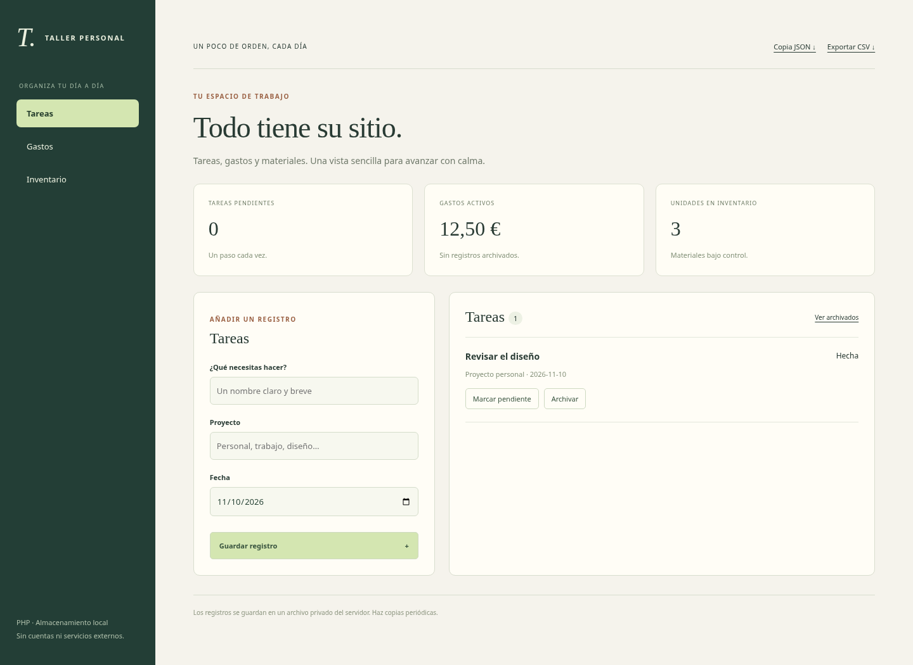

# Aplicaciones-PHP · Taller Personal

Una aplicación local con tres módulos: tareas por proyecto, gastos por categoría
e inventario de materiales. Interfaz adaptable a móvil, exportación JSON/CSV y
archivo reversible de registros. Sin Composer, bases de datos ni servicios externos.

## Ejecutar

Necesita PHP 8.2+ de 64 bits, con sesiones y JSON. Desde la raíz:

```console
php -S 127.0.0.1:8080 -t public
```

Abre `http://127.0.0.1:8080`. Ctrl+C detiene el servidor. Sirve **solo `public`**;
los datos y el código del almacén deben quedar fuera de la raíz pública.
`TALLER_DATA` permite elegir otra carpeta privada de datos; por defecto usa `data/`.
No se incluye autenticación: está pensado para un solo usuario en loopback, no
para publicarlo en Internet ni compartirlo en una red. El servidor integrado de
PHP es para desarrollo, no producción.

## Funciones

- Tareas con proyecto, fecha y estado pendiente/completado.
- Gastos en euros con hasta dos decimales, sumados como enteros en céntimos.
- Inventario con categoría y cantidad de unidades.
- Archivar/restaurar sin borrado permanente, y vista de archivados.
- Copia completa JSON y CSV para consultar fuera de la aplicación.
- Formularios con token CSRF, salida HTML escapada y cookies de sesión HttpOnly.

El almacén utiliza un archivo JSON con bloqueo y reemplazo mediante archivo
temporal. Máximo 10000 registros o 5 MB. No hay sincronización ni copias automáticas.
Exporta el JSON periódicamente. Para restaurar una copia, detén el servidor,
conserva el archivo actual y coloca la copia compatible como `data/datos.json`.
No hay importación por navegador ni ejecución de contenido de los registros.

Las fechas se interpretan como fechas de calendario sin zona horaria; la fecha
sugerida usa la zona del servidor. Los textos se limitan por bytes UTF-8. Los
importes aceptan coma o punto decimal. El CSV neutraliza posibles fórmulas en
campos de texto con un apóstrofo inicial. Las copias contienen tus datos privados.



## Pruebas

`php tests/test.php` usa carpetas temporales. `php tests/http.php` inicia y
detiene su propio servidor local con un almacén aislado. Comprueba importes exactos, estados,
archivo reversible, preservación ante errores y validación del token CSRF.
Se realizan también comprobaciones de navegador contra un servidor local con datos
sintéticos: formularios, persistencia, exportación, entradas maliciosas y vista móvil.
